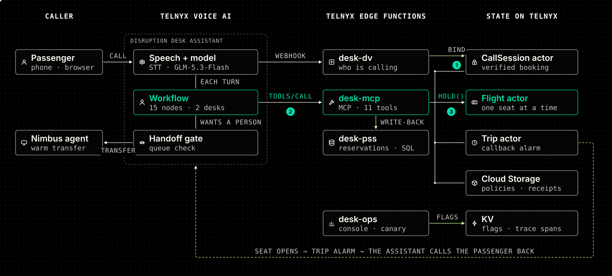

<!-- shape: title -->
FORWARD DEPLOYED ENGINEERING · AIRLINE DISRUPTION

# The phone line that holds up on an airline's worst day

A voice agent on Telnyx that rebooks typhoon callers and never sells the same seat twice.

*Jun Xiong Ong · October 2026*

<!-- notes: 20 seconds. Say the one line and move. -->

---

<!-- shape: findings -->
<!-- section: The story -->
THE PROBLEM

## When a typhoon shuts the airport, everyone calls at once

On that day, the phone line is the airline.

- **Hours on hold** — And the people who hang up never hear back. {clock|On hold}
- **Seats sold twice** — Two agents grab the same seat, so fixing one passenger breaks another. {seats|Seat 14C}
- **The wrong people wait** — Wheelchair users and families queue behind everyone else. {queue|Needs help}

<!-- notes: 40 seconds. -->

---

<!-- shape: architecture -->
<!-- section: The story -->
WHAT I BUILT

## An agent that does four things a hold queue can't

1. **Knows who's calling** — It finds your booking from your phone number and tells you what happened {id|Caller ID}
2. **Gives you a real seat** — Each flight hands out seats one at a time, so none is sold twice {seat|Seat held}
3. **Calls you back** — If nothing fits, you join a waitlist and it rings you when a seat opens {callback|Callback}
4. **Gets you a person** — If someone's free, you're put through. If not, you get a callback {headset|Agent}

<!-- notes: 50 seconds. All of it runs today on a Telnyx trial account. -->

---

<!-- shape: architecture -->
<!-- section: The story -->
HOW IT FITS TOGETHER

## The model talks. My code decides who's calling and who gets a seat.

1. **Recognise** — when the call starts, a webhook finds the booking and ties it to this call
2. **Act** — the agent calls tools on my server, and the server checks every rule
3. **Hold** — each flight hands out its seats one at a time

<!-- notes: Then go live. Squares are requests, circles responses, diamonds changes. -->

---

<!-- shape: architecture -->
<!-- section: Live demo -->
LIVE DEMO

## Five situations, in this order

Two test bookings: T4M8RA, a family of three, and H8N6CU, flying to Tokyo.

1. **Happy path** — It knows my flight is cancelled. I pick a day and a time, free, with a code {seat}
2. **Bad news** — Flight full: waitlist. Nobody free: callback. Still flying: travel credit {clock}
3. **Edge cases** — A family moves together or not at all. Tokyo still pays $100. Mandarin has its own agent {queue}
4. **Show it's healthy** — Green health check, a trace for every call, 200 callers at once with no errors {shield}
5. **Break it on purpose** — "Break MCP" turns the light red, and the call falls back to a callback {toggle}

<!-- notes: Wait about a minute after switching scenario. Switch Break MCP back off after step 5. Pre-flight: web calls as demo caller ON, human queue OPEN, handoff END CALL, fault OFF, one warm-up call. -->

---

<!-- shape: results -->
<!-- section: Under the hood -->
PROOF UNDER LOAD

## 300 callers fought over 60 seats. Exactly 60 were sold.

I sent 300 seat requests at once to one 60-seat flight, with the seat count kept two ways.

| Where the seat count was kept | Callers told yes | Seats on the flight | Oversold |
|---|---|---|---|
| In an actor: requests take turns | 60 | 60 | **0** |
| In a shared number: all read it, then all write it | 300 | 60 | **240** |

<!-- notes: 40 seconds. It tests the seats, not 300 live phone calls. If asked: the shared number also lost count, because each write overwrote the last; after 300 bookings it read 1. -->

---

<!-- shape: findings -->
<!-- section: Under the hood -->
TRADE-OFFS

## Three design choices, and what each one cost

- **Seats in an actor, one request at a time** — No seat is ever sold twice. The cost: requests wait their turn, so 300 at once took 8.5 seconds to clear. {actor|One at a time}
- **Rules in my server, not in the AI's instructions** — The AI can call any tool at any point, so my server checks every rule itself: fees, refunds, and whose booking can change. {code}
- **A faster AI model** — Each reply comes about a second sooner. The Mandarin desk kept the slower model, because the faster one slipped out of Mandarin. {gauge|~1 s faster}

<!-- notes: 50 seconds. -->

---

<!-- shape: timeline -->
<!-- section: Under the hood -->
WHAT BROKE

## The worst bug: phone calls went silent, but chat tests kept passing

It took about 11 test calls to find.

- **What happened** — On a phone call, the desk answered and then said nothing. Over text chat it worked, so every automated test passed.
- **How I tested** — I set up a second AI that phones my desk. Each test call takes about a minute, and nobody has to dial in.
- **How I found it** — I removed half of the conversation flow and called again, and kept going until one piece was left.
- ! **The cause** — On calls, Telnyx turns each route between steps into a tool with the route's name. One name was too long and had a colon, so every reply failed.
- **The fix** — Short route names, an automated check on every name, and a real test call after every change.

<!-- notes: 60 seconds. This is the story they asked for: what broke and how you worked out why. -->

---

<!-- shape: findings -->
<!-- section: Under the hood -->
BUILDING ON TELNYX

## Four things the platform taught me

- **Chat isn't a call** — Calls turn workflow steps into tools; chat doesn't. Only a real call shows those bugs. {phone}
- **The webhook gets 1.2 seconds** — Telnyx stops waiting after about 1.2 seconds, even with an 8-second timeout. I answer within 900 ms. {clock}
- **Tool calls ignore my step limits** — Per-step tool limits don't apply to tool servers, so mine enforces them. {sliders}
- **Mass shutdowns hurt** — 200 idle actors shutting down together crashed the actor host. My health check caught it. {power}

<!-- notes: 60 seconds. Feedback worth taking to the product team. -->

---

<!-- shape: findings -->
<!-- section: Under the hood -->
HEALTHY VS UNHEALTHY

## How I know it's working, and what happens when it isn't

- **A fake caller every minute** — It calls the webhook and the tool server. A failure, or 90 s of silence, turns the light red. {phone}
- **One trace per call** — One ID follows the call through every step, so I can see which hop failed and how long it took. {trace}
- **A switch to break it** — "Break MCP" makes every tool fail. The light turns red, and calls fall back to a callback. {toggle}
- **Fails safe** — If the check for a free person fails, the caller gets a callback, never silence. {shield}

<!-- notes: 45 seconds. -->

---

<!-- shape: findings -->
<!-- section: Under the hood -->
HONEST STATUS

## What works today, and what's still open

- Works: **On real calls** — Rebooking, fees, refunds, travel credit, Mandarin and handoff, all tested on voice calls.
- Open: **Crossed bookings in chat** — In text-chat tests, one conversation touched another booking. Not seen on a call.
- Open: **Lockout didn't lock** — Three wrong verification attempts should lock the caller out. In one test, it didn't.
- Open: **Not production** — Trial account, fees aren't charged, and failed writes aren't retried.

<!-- notes: 45 seconds. They asked for the rough edges. -->

---

<!-- shape: findings -->
<!-- section: Under the hood -->
WHAT'S NEXT

## What I'd build next

- **Fail-safe identity** — If any check disagrees about who's calling, ask the caller to verify again. {id}
- **A real booking system** — Connect Amadeus or Sabre, and retry every failed write. {db}
- **Alert on silence** — My health check once stopped for 28 hours and nobody knew. Silence should page someone. {bell}
- **Load-test real calls** — I've proven 200 at once on the backend, not 200 live voice calls. {bars}

<!-- notes: 30 seconds. -->

---

<!-- shape: divider -->
<!-- section: Close -->
THANK YOU

# A phone line that stays up on the worst day

Jun Xiong Ong · Questions?

---

<!-- shape: divider -->
<!-- section: Appendix · Q&A -->
APPENDIX

# Questions I expect

Press o to jump to any of them.

---

<!-- shape: findings -->
<!-- section: Appendix · Q&A -->
Q1 / ARCHITECTURE

## Why does each piece of data live where it does?

I picked by who writes it and how often.

- **Seats: one actor per flight** — It handles one request at a time, so it can't oversell.
- **The caller: one actor per call** — The key-value store took over a second to read. An actor answers in milliseconds.
- **Settings: key-value store** — Read on every call, changed rarely, flipped without a redeploy.
- **Bookings: SQL** — It stands in for the airline's real reservation system.

---

<!-- shape: findings -->
<!-- section: Appendix · Q&A -->
Q2 / ARCHITECTURE

## Why a step-by-step workflow and not one big prompt?

Anything that has to be exact, I took away from the model.

- **Exact words, every time** — The legal disclosure and refund rights are read word for word.
- **Facts route by rule** — Wheelchair, queue status, a five-minute limit. The model only works out what the caller wants.
- **Handoff runs as code** — The check for a free person runs straight away, not on the caller's next turn.
- **The server has the last word** — Every step can reach every tool, so the server checks every rule.

---

<!-- shape: findings -->
<!-- section: Appendix · Q&A -->
Q3 / TRUST

## How do you stop it from changing the wrong booking?

The model never decides whose booking it's working on.

- **One call, one booking** — My webhook ties the call to a booking when it starts. Every tool looks that up.
- **The server says no** — No confirm without a held seat, no change before you're verified, no flight it never offered.
- Open: **Crossed bookings in chat** — Next fix: verify again whenever the checks disagree.
- Open: **The lockout** — Three strikes should lock the caller out. In one test, it didn't.

---

<!-- shape: findings -->
<!-- section: Appendix · Q&A -->
Q4 / SCALE

## What happens with ten thousand callers?

Telnyx scales the calls. The shared data is what I have to design.

- **Waiting is per flight** — A hold takes about 28 ms inside its flight, so one busy flight doesn't slow the rest.
- **Many flights, many actors** — A real airline spreads across hundreds of flights. I've only load-tested one.
- **Split the hot spots** — One stats counter today. Split it, and queue booking writes with retries.
- Open: **Live call volume** — Untested. The trial account allows two outbound calls at once.

---

<!-- shape: findings -->
<!-- section: Appendix · Q&A -->
Q5 / LATENCY

## Where does the time go on each turn?

My code takes milliseconds. The model takes seconds.

- **My code** — The webhook takes about 260 ms, a tool about 100 ms.
- **The model** — About 6 seconds a turn in chat. A faster model brought it to about 5.
- **The 900 ms rule** — Telnyx stops waiting for the webhook at about 1.2 s, so I answer within 900 ms.
- **Cold starts** — A cold tool server took 14 seconds. The minute-by-minute health check keeps it warm.

---

<!-- shape: findings -->
<!-- section: Appendix · Q&A -->
Q6 / HINDSIGHT

## What would you do differently?

Most of my time went on bugs that only show up on a real call.

- **Real calls from day one** — Chat tests hid the bugs that mattered. {phone}
- **Identity first** — Design who-is-calling to fail safe before building anything on top. {id}
- **Alerts before features** — Know when the health check goes quiet, not only when it fails. {bell}

---

<!-- shape: findings -->
<!-- section: Appendix · Q&A -->
Q7 / WHY TELNYX

## Why build this on Telnyx?

- **One trace, end to end** — One ID from the phone line through the webhook, seat, tool and booking system. {trace}
- **One vendor** — Numbers, carrier, AI models and servers from one company, so one party to call. {stack}
- **Fewer hops** — Should mean less delay. I haven't measured that side by side. {hops}

---

<!-- shape: findings -->
<!-- section: Appendix · Q&A -->
Q8 / A REAL CUSTOMER

## What would you do first with a real airline?

Learn first, then one route with numbers agreed up front.

- **Learn first** — Their booking system, their rebooking rules, and how their call centre hands off. {search}
- **Agree the rules** — Languages, how long recordings are kept, and privacy, before any call is recorded. {doc}
- **One route, measured** — Calls handled, time to rebook, callbacks kept, hang-ups and transfers. {route}
